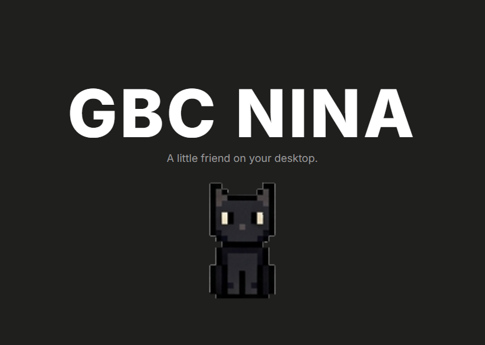

## 项目简介

GBC Nina 是一款轻量级的 Windows 桌面宠物，基于 Python + PySide6 构建。她会陪伴你工作、学习，有自己的情绪和行为节奏——安静但好奇，偶尔主动，大部分时间自处。



> A little friend on your desktop.

核心目标是提供一个**有生命感**的桌面伴侣，而不是一个简单的动画播放器。

### 相关链接

- 仓库地址：[https://github.com/kinguang3/Deskpot-Pet-Cat](https://github.com/kinguang3/Deskpot-Pet-Cat)
- 在线体验：[https://nina.crimsonseraph.top/](https://nina.crimsonseraph.top/)

## 核心功能

### 透明无边框窗口

无边框、透明背景、始终置顶、不在任务栏显示，可以自由拖动到屏幕任意位置。

### 动画系统

支持 7 种动画（idle / walk_left / walk_right / typing / typing_red / watching / sleep），每种动画拥有独立帧率，支持循环和单次播放。

### 行为状态机

通用有限状态机引擎，定义 7 种行为状态，状态之间通过条件自动转换，支持优先级与用户行为打断。

| 状态 | 触发条件 | 转换 |
|------|---------|------|
| Idle | 默认状态 | 随机走动 / 长时间无操作 / 被点击 |
| Walk | 随机走动 | 到达目标后回到 Idle |
| Sleep | 长时间无操作 | 被点击后回到 Idle |
| Watch | 鼠标悬停 | 3 秒后回到 Idle |
| Clicked | 用户点击 | 1.5 秒后回到 Idle |
| Typing | 用户输入中 | 停止输入后回到 Idle |
| Dragged | 拖动窗口 | 松开后回到 Idle |

### 鼠标交互

支持单击、双击、右键、拖动、鼠标悬停以及长时间无交互检测，将原始输入转化为语义化事件。

| 操作 | 效果 |
|------|------|
| 拖动 | 移动 Nina 的位置 |
| 单击 | Nina 会看你一眼并说话 |
| 双击 | 触发特殊动画（typing / watching） |
| 右键 | 显示对话 |
| 鼠标悬停 | 30% 概率显示对话 |
| 长时间不互动 | Nina 会自己睡着 |

### 对话气泡

圆角气泡 + 三角尾巴，根据当前时间（早/中/晚/深夜）、Nina 状态和用户行为动态选择对话内容，对话间隔 30~60 秒随机，避免频繁打扰。

### 语音唤醒与自定义指令

基于 Vosk 离线语音识别，说"嘿，Nina"即可唤醒，非 sleep 状态下可直接说命令。用户还能在设置面板中自定义语音触发词与对应动作（打开网页 / 打开应用）。

### 系统托盘与设置面板

猫爪图标托盘菜单支持显示 / 隐藏 / 设置 / 退出；设置面板可调整窗口大小（50%~200%）、透明度（30%~100%）、始终置顶、自动移动、对话开关等，配置持久化到 `config/user.json`。

## 技术架构

项目采用分层设计，模块之间通过**事件总线（EventBus）**解耦通信，不直接引用彼此，便于扩展和维护：

- **核心层 (core)**：透明窗口管理、宠物实体、事件总线、配置管理
- **动画层 (animation)**：精灵图加载器 + 动画管理器
- **行为层 (behavior)**：有限状态机引擎与行为状态定义
- **交互层 (interaction)**：鼠标事件处理
- **对话层 (dialogue)**：气泡 UI + 对话内容管理
- **界面层 (ui)**：系统托盘、设置面板
- **语音层 (voice)**：唤醒词检测、命令解析、动作执行
- **工具层 (utils)**：JSON 数据持久化

```
用户操作 → Interaction → EventBus → Behavior(决策) → Animation(播放)
                                        ↓
                                  StateManager(更新状态)
                                        ↓
                                   Dialogue(显示对话)
```

## 快速开始

```bash
# 获取源码
git clone https://github.com/kinguang3/Deskpot-Pet-Cat.git
cd Deskpot-Pet-Cat

# 创建虚拟环境并安装依赖（Windows PowerShell）
python -m venv .venv
.\.venv\Scripts\Activate.ps1
pip install -r requirements.txt

# 运行
python main.py
```

也可以直接双击 `run.bat`，自动使用虚拟环境启动。启动后 Nina 会出现在屏幕底部中间位置，播放 idle 动画。

### 环境要求

- Windows 10 / 11
- Python 3.10 或更高版本

## 总结

GBC Nina 用事件驱动的分层架构，把"一只猫"拆解成了窗口、动画、行为、交互、对话和语音几个相对独立的模块。相比单纯的动画播放器，状态机和对话系统让她看起来更像一个有自己的节奏的小家伙。

如果你也想要一只住在桌面上的小猫，欢迎到[仓库](https://github.com/kinguang3/Deskpot-Pet-Cat)看看，Issue 和 PR 都欢迎。
