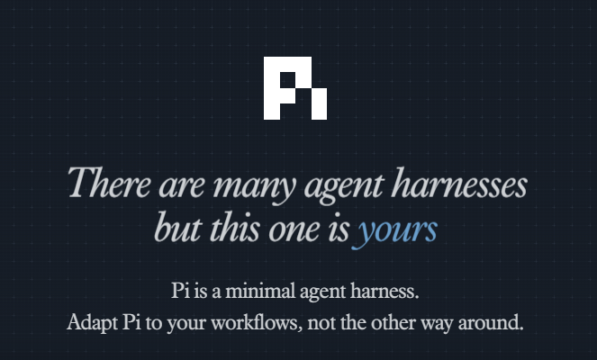

## 什么是 Pi

Pi 是一个最小化的 Agent Harness。它的核心理念是：

> **让 Agent 适应你的工作流，而不是相反。**

与其他复杂的 Agent 框架不同，Pi 专注于提供精简的基础设施，让你能够快速构建和部署 AI Agent。

## Pi 的工作流程

### Planning（规划阶段）

在这个阶段，Agent 会：

- 分析用户输入的需求
- 自我规划完成任务所需的步骤
- 建立追踪机制来监控任务进度

### Processing（处理阶段）

这是核心执行阶段，Agent 会：

- 调用工具和 API
- 处理数据和信息
- 根据需要进行调整和迭代
- 自我验证结果的正确性

### Publishing（发布阶段）

最后，Agent 会：

- 验证所有任务是否完成
- 生成摘要交付物
- 提供链接指向已保存的产出

## 核心特性

### 自我规划

Agent 能够根据用户需求自主规划任务步骤，而不需要人类逐步指示。

### 可追踪的进度

通过 Todo List 机制，每一步任务都有明确的状态追踪，确保不会遗漏。

### 可验证的产出

每一步完成后都生成可验证的产出物，确保质量。

## 为什么选择 Pi

| 特性 | 优势 |
|------|------|
| 极简设计 | 学习曲线平缓，快速上手 |
| 灵活架构 | 可以轻松适配现有工作流 |
| 可扩展性 | 支持自定义工具和 API |
| 透明工作流 | 每一步都清晰可追踪 |

## 实际应用场景

### 代码开发助手

- 自动分析代码仓库结构
- 生成代码审查报告
- 提供优化建议

### 文档撰写

- 自动收集资料
- 生成结构化文档
- 支持多种格式输出

### 数据处理

- 自动抓取和整理数据
- 生成分析报告
- 可视化展示结果

## 总结

Pi Agent 提供了一种优雅的方式来构建 AI Agent。它的核心理念——让 Agent 适应你的工作流，而不是相反——使得它在实际应用中非常灵活和强大。

通过理解其 Planning → Processing → Publishing 的工作流程，你可以：

1. 快速入门 Agent 开发
2. 将 Agent 集成到现有工作流中
3. 构建可验证、可追踪的 AI 应用

---

**开始学习 Pi，让 AI Agent 真正为你所用。**
