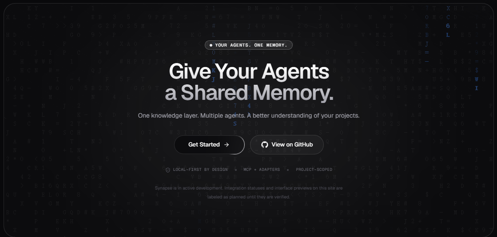

## 上下文不会自己传递

今天的编码 Agent 已经足够聪明，真正的问题往往出在任务开始之前：它们对这个项目一无所知。

- 每个 Agent 从零开始，各自带着独立的上下文窗口和对项目的理解。
- 文件、决策和约定散落在不同工具与会话之间。
- 一次改动背后的原因，很少能保留到下一个任务或下一个 Agent。
- 换一个 Agent，就要把同样的项目理解重新建立一遍。

Synapse 想解决的就是这件事：让多个 Agent 共享同一份项目记忆。

## Synapse 是什么

Synapse 是一个**本地优先（local-first）的 MCP 服务**。它把项目、源码、文档、显式记忆以及它们之间的关系存入 SQLite，并通过 MCP、CLI 和本地 GUI 暴露同一套知识。

换句话说，它不是又一个聊天界面，而是运行在你已有 Agent 之下的知识与记忆基础设施。



## 核心能力

### 共享的项目记忆

不同 Agent 读写的都是同一份按项目隔离的记忆。一个宿主里做出的决策，下一个宿主可以直接使用。

### 本地优先

索引保存在你的机器上，并且限制在项目边界内，核心流程不依赖云端。数据默认落在 `%LOCALAPPDATA%\Synapse\Synapse\`，包含 `config.toml` 与 `synapse.db`。

### 混合检索

关键词搜索、精确符号查找与相关知识共享同一套检索入口。底层使用 SQLite + FTS5 全文索引，并针对中文做了 unigram/bigram 处理。

### 类型化的知识图谱

项目结构、文件关系和记忆被组织成一张可探索的类型化图，支持引用解析、跨文件关系和基于图的检索扩展。

### MCP 跨 Agent 集成

MCP 是统一接口，宿主适配层负责抹平不同 Agent 之间的差异。内置的 stdio MCP Server 提供 9 个项目级工具，覆盖搜索、图探索、上下文与记忆。

### 持久上下文

会话会结束，但重要的知识不会。Synapse 支持 `fact`、`experience`、`decision`、`preference`、`summary` 五类显式记忆，并提供按项目、类型、关键词过滤的分页查询。

## 它如何工作

整体流程可以概括为三步：

1. **索引**：使用 tree-sitter 解析 Python AST，结构化解析 Markdown，其他常见文本格式回退到文件级节点。
2. **存储**：源码、文档、记忆与关系写入 SQLite，并用 FTS5 建立全文索引。
3. **检索与记忆**：通过 CLI、MCP 或 GUI 进行搜索、图探索、上下文构建与记忆存取。

其中 `context` 命令会根据查询对相关模块排序、覆盖不同路径，并按照 token 预算裁剪可选内容，方便直接喂给 Agent。

## 快速上手

```powershell
cd C:\path\to\Synapse
python -m venv .venv
.\.venv\Scripts\Activate.ps1
python -m pip install -U pip
python -m pip install -e ".[dev]"
```

初始化并检查环境：

```powershell
synapse config init
synapse doctor
```

注册项目、建立索引、检索与记忆：

```powershell
synapse projects register . --index
synapse projects status

synapse search "ContextBuilder" --limit 5
synapse context . --query "retrieval module" --max-tokens 700

synapse remember . "Use SQLite FTS5 for local retrieval." --type decision --title "Use FTS5"
synapse recall "FTS5" --limit 5
```

如果要接入外部 Agent，可以配置 stdio MCP Server：

```json
{
  "mcpServers": {
    "synapse": {
      "command": "C:\\path\\to\\Synapse\\.venv\\Scripts\\synapse-mcp.exe",
      "args": [],
      "env": {
        "SYNAPSE_HOME": "C:\\path\\to\\synapse-home"
      }
    }
  }
}
```

此外还有可选的本地 GUI，提供知识图谱探索、搜索、记忆浏览、上下文预览与索引状态管理：

```powershell
python -m pip install -e ".[gui]"
python -m synapse.integrations.gui --port 8765
```

## 当前边界

Synapse 目前已经可以作为本地知识服务使用，但也有清晰的能力边界：

- 检索只提供 `keyword` 与 `hybrid`，`semantic` 并非真正的向量语义检索，任何入口都未暴露。
- 尚未实现文件监听、向量检索、记忆编辑/版本管理和云同步。
- `synapse_recall` 返回摘要与片段，读取完整内容需要用 `synapse_memory_get`。
- 上下文排序基于词法与图结构，而不是语义。

把这些边界明确写出来，反而让它更适合作为可靠的基础设施来使用。

## 适用场景

- 在多个 Agent 之间共享项目约定与架构决策。
- 让新会话快速恢复对代码结构的理解。
- 为老项目建立可检索的知识索引，减少重复摸索。
- 把关键决策沉淀为可查询、可复用的记忆。

## 相关链接

- 项目介绍：[https://synapse-mcp.cc.cd/](https://synapse-mcp.cc.cd/)
- GitHub：[https://github.com/kinguang3/Synapse](https://github.com/kinguang3/Synapse)

---

**让每个 Agent 都从同一份项目记忆出发。**
